# Raman Lab KE

**Last updated: 30 October 2026** · [Public repository](https://github.com/haknuza/raman-lab-ke)

The goal is to use an existing Avantes Raman instrument with the motion system
of a Creality Ender-3 V3 KE to measure spectra at known sample positions and
produce spatial Raman maps across a target area of 220 x 220 mm. Samples can
change between experiments; scan area, spacing, focus and measurement settings
belong in configuration rather than being fixed in the pipeline.

**The software workflow has been demonstrated with simulation. The printer has
not yet been physically converted into a validated Raman scanner.**

The repository combines the Raman pipeline with reusable camera, printer and
chat components. See [the project layout](docs/PROJECT_LAYOUT.md) for folder names
and [source attribution](NOTICE.md) for upstream credits. Local manuals, device
configuration, credentials and experiment outputs are excluded from Git.

## Work completed

- Reviewed the supplied Avantes PDFs, JSON conversions and laboratory SOP to
  document the likely instrument configuration, probe geometry, focusing and
  control interfaces. The exact installed instrument and optics still need
  confirmation. Findings are in [the hardware plan](docs/RAMAN_SCANNER_PLAN.md).
- Built a configurable Raman pipeline: grid planning, coordinate transforms,
  simulated acquisition, dark references, raw spectrum storage, interruption and
  resume, saturation handling, processing, reporting and CSV import/export.
- Completed a 25-position demo and a full 220 x 220 mm simulation at 5 mm spacing,
  recording **2,025 synthetic spectra**. This validates software flow and storage,
  not physical coverage or positioning accuracy.
- Reviewed and reduced the PhotonicsAI source project. Preserved its chat
  dashboard, calibrated camera stack, printer safeguards and optional phone
  adapter. Removed 20 obsolete/demo-delivery files totaling approximately
  **25.45 MiB** from the working tree. See [the reuse review](docs/RAMAN_REUSE.md).
- Consolidated the software into one project with renamed components, updated
  path references, setup/check scripts and repository-level CI configuration.
  Created and published this separate public Git repository while preserving
  upstream attribution and the original local Git archive.
- Excluded supplied vendor manuals, laboratory documents, credentials, local
  machine configuration and experiment outputs from the public source set.

## Current implementation status

| Component | Implemented | Remaining work |
| --- | --- | --- |
| Raman pipeline | Planning, simulation, durable raw data, resume, analysis and reports | Validate acquisition with the real instrument |
| Instrument interface | External driver protocol and bridge client | Implement the compatible Avantes SDK and actual laser-controller driver |
| Printer control | Moonraker adapter plus the retained bounded SSH/MCP interface | Confirm the installed printer API and commission motion with the final probe mount |
| Camera vision | Retained capture, frame storage, planar calibration, colored-region detection and preview | Configure this setup's geometry and connect sample regions to Raman scan planning |
| Chat dashboard | Preserved interface, orchestration and image-evidence tools | Replace inherited erasing actions with Raman scan actions |
| Height and focus | Configurable focus height and optional measured plane slopes | Measure focus tolerance and decide whether height sensing/autofocus is needed |

The inherited camera calibration assumes a **200 x 200 mm board and a (+9, +8) mm
printer offset**. Those values are not calibrated for this Raman installation.
The existing color detector is not a general detector for arbitrary samples.
No camera or LiDAR hardware has been selected for the final system.

## Next work

1. Confirm the actual spectrometer, laser controller and installed lens; obtain
   the compatible SDK and establish supported laser control.
2. Measure and design the probe mount, establish the coordinate transform and
   reachable workspace, and validate clearance and focus with the final hardware.
3. Make camera geometry configurable, calibrate it to sample coordinates, and
   generate scan grids from selected sample regions.
4. Connect real acquisition and printer motion, then replace the dashboard's
   erasing workflow with Raman controls. Validate a stationary spectrum and a
   small grid before attempting a full-area measurement.

These are pending milestones, not completed hardware capabilities. Suitable
beam containment, hardware interlocks and an independent fail-off response are
part of commissioning the laser system.

## Quick start

Use Python 3.10 or newer on Linux or Windows. The core has no third-party dependencies. Run commands from this directory.

```bash
python -m raman_scanner plan --machine profiles/machine.simulation.json --scan profiles/scan.demo.json
python -m raman_scanner run --machine profiles/machine.simulation.json --scan profiles/scan.demo.json --output runs/my-demo
```

Open `runs/my-demo/report.html` in a browser. The self-contained report works offline. Click a map position to see its spectrum and switch between raw and dark-corrected counts. Reports embed at most 256 representative spectra; all spectra remain in the run database. A gray map cell is missing or flagged.

The local `runs/demo/report.html` is a completed 25-point synthetic example. Run
outputs are ignored by Git; a fresh clone can generate its own report with the
commands above. Simulations do not wait for the configured exposure time;
duration estimates still use the configured integration and averaging settings.

## What happens in a run

```mermaid
flowchart LR
    A[Machine and scan profiles] --> B[Validate coordinates and bounds]
    B --> C[Initialize devices with laser off]
    C --> D[Record dark reference]
    D --> E[Move and wait for completion]
    E --> F[Settle and acquire spectrum]
    F --> G[Disable emission]
    G --> H[Save raw data and coordinates]
    H -->|next position| E
    H --> I[Dark subtraction and band integration]
    I --> J[Offline report and CSV export]
```



The hardware motion path raises to the configured travel Z, traverses XY, then descends to focus. Travel Z must clear the complete sample, mount and fixture envelope, including the initial vertical path. Configuration validation checks numerical bounds, not physical collision geometry. The pipeline never automatically homes, starts a print, heats, or extrudes.

## Change the sample without changing the pipeline

Copy `profiles/scan.demo.json` and edit the copy for each experiment:

| Setting | Purpose |
| --- | --- |
| `sample_id`, `notes` | Record the sample and experimental context. |
| `grid.x_mm`, `grid.y_mm` | Sample coordinates for the region of interest. |
| `grid.pitch_mm` | X and Y sampling intervals. Both requested edges are included; the final interval can be shorter than the pitch. |
| `grid.pattern` | `raster` or `serpentine`; verify effects of direction reversals before using serpentine on hardware. |
| `focus.machine_z_mm` | Commanded printer Z at the reference sample coordinate. This is not the probe's optical working distance. |
| `focus.slope_x`, `focus.slope_y` | Optional measured plane slopes in mm/mm. Defaults are zero; this is not autofocus or a general height map. |
| `focus.reference_sample_mm` | Sample coordinate at which `machine_z_mm` applies. |
| `focus.calibration_id`, `focus.lens_id` | Identify the focus setup and installed optics. |
| `acquisition.integration_ms`, `averages` | Exposure time per integration and number of averaged integrations. |
| `acquisition.laser_nm` | Calibrated excitation wavelength used for the Raman shift conversion. |
| `acquisition.laser_setting` | Recorded instrument setting with units; it is not a measured sample-plane power. The hardware driver must confirm it. |
| `acquisition.settle_s`, `laser_settle_s` | Delays after movement and laser enable, respectively. Establish these experimentally. |
| `acquisition.adc_max` | Optional detector saturation threshold, if established for the actual instrument. |
| `analysis.band_cm1`, `baseline` | Feature-integration band and optional straight baseline between its endpoints. |

`profiles/scan.full-bed.json` targets 220 x 220 mm at 5 mm pitch: 2,025 positions. At one 3-second integration, exposure alone takes 1.69 hours. Finer grids cost considerably more time. The nominal print area does not establish the reachable Raman area.

The machine profile defines calibrated bounds, the sample origin in printer coordinates, and the sign of each XY axis:

```text
commanded_X = sample_origin_X + axis_sign_X * sample_X
commanded_Y = sample_origin_Y + axis_sign_Y * sample_Y
commanded_Z = focus_Z + slope_X * (sample_X - reference_X)
                      + slope_Y * (sample_Y - reference_Y)
```

Calibrate this transform with actual marked sample positions; printer bed motion alone does not establish the sign convention. Tilt compensation assumes a measured plane. Curved surfaces require a later height-map or autofocus implementation.

## Pause and resume

```bash
python -m raman_scanner run --machine profiles/machine.simulation.json --scan profiles/scan.demo.json --output runs/resume-demo --stop-after 7
python -m raman_scanner status runs/resume-demo
python -m raman_scanner run --machine profiles/machine.simulation.json --scan profiles/scan.demo.json --output runs/resume-demo --resume
```

Completed spectra are inserted transactionally and are never overwritten. A resumed session takes a fresh dark and links newly acquired points to it. Machine, sample, optics, and acquisition profiles must match the saved configuration exactly. If the sample moved or focus changed, create a new run. Resume also checks the instrument identity, but cannot detect physical sample movement.

An error stops acquisition and attempts to disable emission and stop motion. It does not automatically home or retract. An off-confirmation failure preserves any valid readout in `uncommitted-captures/`, without marking that point complete. Independent hardware interlocks/watchdogs remain necessary: a host application cannot guarantee laser shutdown after a computer, network, or driver failure.

An exclusive `.run-lock` prevents two owners of the same run directory. If a process crashes, the lock may remain. Remove it only after verifying that the old process and devices have stopped. It does not prevent a different application or run directory from controlling the same hardware; hardware scanning requires exclusive ownership of the printer and instrument.

## Reprocess and export

```bash
python -m raman_scanner analyze runs/my-demo --band 1540 1660
python -m raman_scanner export runs/my-demo --output runs/my-demo/spectra.csv.gz
python -m raman_scanner spectrum runs/my-demo 0 --output runs/my-demo/point-0.csv
```

Analysis regenerates `points.csv`, `summary.json`, and `report.html` without editing raw spectra or the original configuration. It uses:

```text
Raman shift (cm^-1) = 10^7 * (1 / excitation_nm - 1 / wavelength_nm)
dark-corrected counts = raw counts - associated dark counts
band area = trapezoidal integral over the selected Raman interval
```

Band endpoints are interpolated. With `linear_endpoints`, a line between the band endpoints is subtracted only for band integration. No automatic smoothing, fluorescence fitting, cosmic-ray removal, concentration prediction, or chemical identification is performed. Areas are not normalized for exposure, averaging implementation, or optical power. Saturated points retain raw data but are excluded from the displayed quantitative map.

`run.sqlite` contains configuration and hashes, instrument identity, raw wavelength/count arrays, dark references, coordinates, timestamps, quality flags and an event log. Machine coordinates are commanded values, not independently measured positions. `spectra.csv.gz` streams the complete spectral dataset in long format, with raw, dark, corrected counts and Raman shifts. Back up the entire run directory.

## Use existing Raman exports

Normalize raw exported spectra to UTF-8 comma-separated CSV with these headers:

```csv
wavelength_nm,counts
800.0,123
800.5,145
801.0,138
```

Alternatively use `raman_shift_cm1,counts` with the correct excitation wavelength in the scan profile. All axes must be increasing and match the dark spectrum. Do not label an already dark-corrected or baseline-subtracted export as raw counts.

Create an index file linking each spectrum to a scan-plan point. Paths are relative to the index file:

```csv
point_index,path
0,point-0.csv
1,point-1.csv
```

Export the planned coordinate list to make the association explicit:

```bash
python -m raman_scanner plan --machine profiles/machine.simulation.json --scan profiles/scan.demo.json --csv planned-points.csv
python -m raman_scanner import-csv --machine profiles/machine.simulation.json --scan profiles/scan.demo.json --index spectra-index.csv --dark dark.csv --output runs/imported
```

Import never connects to hardware. It preserves source-file hashes and labels the data as imported, even when a simulation geometry profile supplied coordinates. Coordinate association, exposure settings and calibration are user supplied. File modification time is recorded as an unverified timestamp; saturation is unknown unless `adc_max` is configured. Partial imports can be analyzed. A failed import retains already stored data for inspection; use a new directory for a corrected import. Imported data cannot be resumed as a simulated or hardware acquisition.

## Connect hardware later

The core is ready for device integration without deciding the host OS now. The unresolved work is specific to the installed equipment:

1. Confirm the printer exposes a usable Moonraker API; stock Creality firmware is not assumed to do so. The adapter implements its documented HTTP endpoints and waits for `M400` plus a reported target position.
2. Obtain the compatible Avantes SDK and official Python wrapper for the selected OS and exact spectrometer. Implement the instrument bridge described in [the driver protocol](docs/INSTRUMENT_BRIDGE.md), including the actual supported laser-control interface. This repository does not guess that interface or vendor structure layouts.
3. Calibrate reach, coordinate signs, focus, clearance, speed, acceleration and settling with the final mount. The motion adapter uses configured feed rates and the printer's existing acceleration limits; set suitable acceleration during commissioning.
4. Copy `profiles/machine.hardware.template.json` and replace every null/placeholder with measured values. Its missing geometry deliberately prevents execution. Set real sample/optics settings in a separate scan profile. The template's optional API-key environment variable must exist if retained.
5. Establish suitable containment, functioning interlocks and an independent fail-off response. Validate a stationary spectrum and a small grid before expanding coverage.

Only the explicit hardware command connects to physical devices:

```bash
python -m raman_scanner run --machine profiles/machine.actual.json --scan profiles/scan.actual.json --output runs/actual-001 --hardware
```

The first motion adapter requires homed XYZ, no active/paused print, heaters targeted off, zero live velocity, no active bed mesh, 100% speed override, and matching G-code/native coordinates. It does not alter these prerequisites or automatically home the modified toolhead. It does not implement autofocus, automatic collision detection, printer rooting, or firmware installation.

## Validation and source material

The following are the **last recorded successful checks**, not a claim that
every component has been validated on hardware:

| Verification | Recorded result | Scope |
| --- | --- | --- |
| Standalone Raman tests | 31 passed | Planning, acquisition ordering, data/reference handling, resume, failures, import/export and processing |
| Printer tests | 143 passed | Mock printer, bounded commands, policy checks, local Unix sockets and stdio MCP |
| Selected camera tests | 60 passed | Synthetic images, calibration, tracking, storage, HTTP routes and camera sources; camera stdio MCP excluded |
| Report interaction checks | Passed for 25- and 2,025-position reports | Offline map selection, signal switching, chart drawing calls and CSV generation with mocked document/canvas |
| Repository checks | Passed | Python syntax, component selection, path updates, Git whitespace checks and public-source audit |

The dashboard regression/browser suites, optional phone adapter suite, camera
stdio MCP integration and a fresh install of every pinned dependency have not
been completed. Report interaction checks do not establish visual layout
quality. No real printer movement or Raman laser operation was performed.
Detailed environment and scope notes are in [the validation record](docs/VALIDATION.md).

To run the standalone Raman suite:

```bash
python -m unittest discover -s tests -v
```

Tests cover full-bed planning, transforms, invalid bounds/settings, acquisition ordering, interruption and resume, saturation, reference compatibility, imports/exports, bridge timeouts and motion completion. Device adapter tests use fixtures, not physical hardware.

The optional report interaction check uses Node.js without a browser or external dependencies:

```bash
node tests/check_report.cjs runs/demo/report.html
```

This exercises map selection, signal switching, chart drawing calls and CSV download generation with a mocked document/canvas. It does not verify the rendered visual layout.

The locally supplied PDFs, JSON conversions and SOP informed the design in [the hardware plan](docs/RAMAN_SCANNER_PLAN.md). They are kept under `documentation/instruments/` and excluded from the public repository. Official interface references:

- [Moonraker printer API](https://moonraker.readthedocs.io/en/latest/external_api/printer/)
- [Klipper G-code reference](https://www.klipper3d.org/G-Codes.html)
- [Avantes official Python SDK example](https://avantesusa.com/wp-content/uploads/2022/10/Python-Updates_October-2022.pdf)

The Avantes example is evidence of the SDK acquisition flow, not proof of compatibility with the unverified installed instrument. Dark subtraction and wavelength calibration remain distinct operations.

## Camera, printer and dashboard components

`sample-vision/`, `printer-control/`, `dashboard/` and `camera-adapter/` contain the
retained PhotonicsAI foundations. Their runtime paths and setup options use the
new folder names. The dashboard remains available as requested; its existing
actions still implement erasing and are not yet Raman scan controls.

```sh
python3 scripts/setup.py --list
python3 scripts/setup.py --with-dashboard
python3 scripts/check.py --with-dashboard
```

Use macOS/Linux and Python 3.11+ for the upstream component setup. By default,
setup installs only `sample-vision` and `printer-control`; the dashboard and
phone adapter are optional. See [the reuse review](docs/RAMAN_REUSE.md) for
inherited geometry and remaining integration work.

## Progress log

### 30 October 2026

- Established the Raman scanner architecture from the supplied documentation and
  the 220 x 220 mm coverage goal.
- Implemented and tested the sample-configurable software pipeline, including
  successful small-grid and full-bed simulations.
- Audited PhotonicsAI, removed unrelated delivery material and the obsolete
  triangle demo, and retained the chat dashboard as the future UI foundation.
- Renamed and consolidated the components into `raman-lab-ke`; published the
  initial project on the `main` branch of the public GitHub repository.
- Expanded this README into a living record of completed work, current
  limitations, verification and next milestones.

Update this README with each meaningful project change. Keep current status and
commands accurate, append dated progress entries for notable milestones, and
record what was actually tested. Mark planned features and simulation results
clearly; only record hardware validation after it has been performed.
